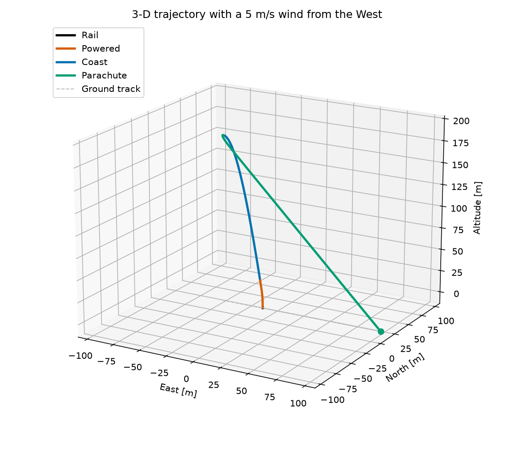
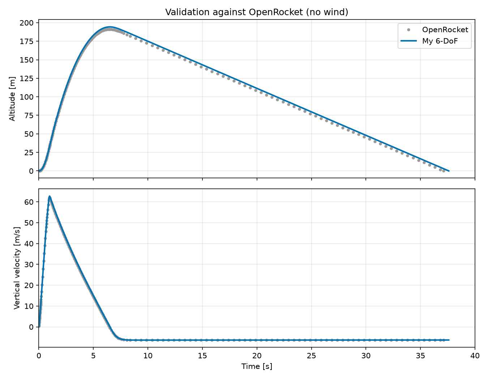
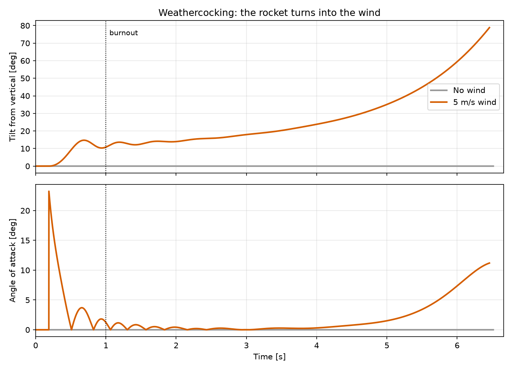

# 6-DoF Rocket Flight Simulator

A six-degree-of-freedom flight simulator for a high-power model rocket, written from scratch in Python and validated against OpenRocket. It simulates the launch rail, powered flight, coast and parachute descent, and shows how the rocket reacts to wind.

The vehicle is the AeroTech F62T-6 rocket from my previous projects: [TVC attitude control](https://github.com/Pighetti690/rocket-tvc-attitude-control), [multi-phase flight](https://github.com/Pighetti690/rocket-multiphase-flight-simulation) and [EKF navigation](https://github.com/Pighetti690/rocket-ekf-navigation).

**[Open the interactive 3-D trajectory](https://pighetti690.github.io/rocket-6dof-simulator/)**

## Does it match OpenRocket?

With no wind, my simulator reproduces the OpenRocket flight within 2% on every key quantity, and the rocket leaves the rail at exactly the same instant.

| | OpenRocket | My 6-DoF | Difference |
|---|---|---|---|
| Rail exit time | 0.188 s | 0.188 s | 0.0% |
| Maximum velocity | 62.1 m/s | 62.8 m/s | +1.1% |
| Apogee | 191.3 m | 194.3 m | +1.6% |
| Time to apogee | 6.48 s | 6.52 s | +0.5% |
| Landing velocity | 6.31 m/s | 6.31 m/s | +0.1% |
| Flight time | 37.1 s | 37.6 s | +1.3% |

## What happens with wind?

With a 5 m/s wind from the West, the rocket leaves the rail with a 23° angle of attack. The fins push the tail downwind, so the nose turns **into** the wind (weathercocking): after a few damped oscillations the rocket is flying 11° off vertical at burnout. Under the parachute, the wind then carries it 109 m downwind of the pad.

| | No wind | 5 m/s wind |
|---|---|---|
| Apogee | 194.3 m | 189.2 m |
| Angle of attack off the rail | 0° | 23.1° |
| Tilt into the wind at burnout | 0° | 10.8° |
| Landing distance from the pad | 0 m | 109 m |

The model

**State (13 variables):** position and velocity in an Earth-fixed frame (East, North, Up), attitude as a unit quaternion, angular rates in body axes.

**Translation:** Newton's second law, with thrust along the rocket axis, gravity and aerodynamic forces.

**Rotation:** Euler's equations for a rigid body, $I\dot{\boldsymbol\omega} = \mathbf M - \boldsymbol\omega \times I\boldsymbol\omega$, and the quaternion kinematics $\dot q = \tfrac12\, q \otimes [0, \boldsymbol\omega]$.

**Aerodynamics:**
- drag coefficient from OpenRocket, as a function of airspeed;
- normal force $N = \tfrac12 \rho V^2 A\, C_{N\alpha}\, \alpha$ applied at the centre of pressure, both computed with the **Barrowman method** ($C_{N\alpha} = 13.1$ /rad, CP at 77.7 cm from the nose, identical to OpenRocket);
- pitch damping from the nose and fins plus **jet damping** from the exhaust mass flow.

**Mass properties:** mass, inertia and centre of gravity vary during the burn, from OpenRocket.

**Phases:** 1-D motion along a 1 m launch rail, full 6-DoF flight to apogee, parachute descent as a point mass with drag.

**Integration:** fixed-step 4th-order Runge-Kutta, 1 ms step, quaternion re-normalised at every step.

**Author:** Francesco Pighetti — Aerospace Engineering student, Politecnico di Torino
